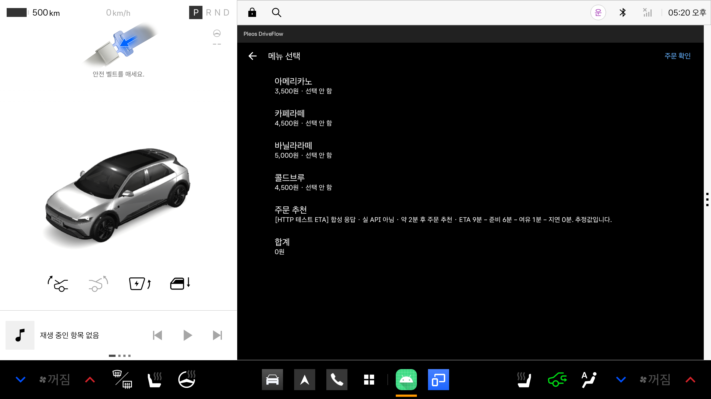

# Pleos DriveFlow v0.3.0 개발 결과

작성일: 2026-10-30. 로컬 브랜치 `codex/tmap-eta-v030`, 기준 main `a418563`(PR #2 병합 포함). 원격 push, PR 생성, 릴리스 생성, 기존 태그 변경은 하지 않았다.

## 결과

실제 TMAP 자동차 경로 요청을 수행하는 서버 프록시와 Android 클라이언트 구현을 추가했다. Android 현재 위치와 가상 매장 테스트 좌표를 보내 ETA를 받고 기존 주문 추천 계산식에 연결한다. Mock/Real을 명시적으로 전환할 수 있으며 기본값은 Mock이다. ETA 상태 변경은 메뉴·주문 확인·설정 화면을 갱신한다.

**발급된 TMAP appKey로 실 API 성공 응답을 받은 것은 아니다.** 서버 계약·오류는 자동 테스트로, 위치→HTTP→추천→화면 연결은 에뮬레이터와 합성 응답으로 검증했다. 실제 키 인증·계약별 한도·외부 TMAP 서비스 성공 응답은 사용자가 서버에 키를 입력한 뒤 최종 확인해야 한다. 키는 채팅에 보내지 않고 실행 도구의 숨김 입력으로 넣는다.

## 주요 변경

| 영역 | 구현 |
|---|---|
| ETA 인터페이스 | 기존 분 단위 조회 유지, 목적지·출처 상태·리스너 확장 |
| Real/Mock 공급자 | 30초 조회 간격, 60초 유효기간, 모드·목적지별 늦은 응답 무시, foreground 수명 관리 |
| Android 위치/HTTP | LocationManager, 런타임 권한, 최신/정확도 검사, 취소·타임아웃, HTTPS 기본 |
| 서버 | TMAP appKey 서버 보관, 응답 totalTime 파싱, 인증·토큰 만료·세션/분당 호출 제한 |
| 개발 실행 도구 | 현재 AAOS 사용자에 단기 토큰 주입, adb reverse, 키 없는 --fixture 테스트, 종료 시 정리 |
| UI | Mock/TMAP/합성 응답 구분, 오류 시 도착 후 주문, 정차 전용 모드 변경·권한 요청·갱신 |
| 보안 설정 | 토큰 소스/APK 제외, 클라우드 백업·기기 이전 제외, debug localhost만 HTTP 허용 |
| 버전 | automotive/mobile versionName 0.3.0, versionCode 3; Git 릴리스 태그와 별개 |

실제 결제·POS·매장 검색·VHAL 연동은 추가하지 않았다. 실제 장소를 주문 가능한 매장으로 표시하지 않는다. 가상 매장의 좌표는 경로 테스트용이며 매장 진입로 정보도 아니다.

## 자동 검증

실행: `JAVA_HOME='/Applications/Android Studio.app/Contents/jbr/Contents/Home' ./gradlew test :automotive:assembleDebug :mobile:assembleDebug`

- Gradle `test`에 등록된 전체 테스트 35개 통과: shared 기존 20 + ETA 13, automotive 1, mobile 1. 현재 구성에서 실행된 테스트 태스크는 각 모듈의 `testDebugUnitTest`다. release 변형 테스트 실행을 별도로 주장하지 않는다.
- `python3 -m unittest discover -s server -v`: 서버 12개 통과.
- Automotive/Mobile debug APK 빌드 성공.
- `git diff --check` 통과. APK에 런타임 `eta-proxy.json` 없음 확인.
- Gradle 10과 호환되지 않는 deprecated feature 경고는 기존 빌드 설정에 남아 있다.

ETA 테스트는 초→분 올림과 추천 재계산, 모든 오류에서 null 처리, 만료, 모드·목적지 변경 시 오래된 응답 무시, 호출 제한, background 중단, 리스너 해제, 모의 위치·합성 응답 표시를 다룬다. 서버 테스트는 실제 로컬 HTTP 요청, 인증/만료, 429/한도, 좌표 검증, 응답 누락/비정상 숫자, 공급자 401/429/500, 네트워크 오류, 타임아웃, JSON 오류를 다룬다. 공급자 응답은 테스트 대역이다.

## Pleos 에뮬레이터 검증

환경: Pleos_Connect_v2.1.0, API 34, 현재 AAOS user 10. ADB로 최종 APK 설치·실행 성공. 에뮬레이터의 시계는 호스트와 달라 캡처/로그 시각은 개발일과 다를 수 있다.

| 시나리오 | 관찰 |
|---|---|
| 기본 Mock·설정 진입 | UNKNOWN에서 시작, 데모 PARKED 설정 후 ETA 설정 진입 |
| 위치 권한 없음 | 메뉴에 정확한 위치 권한 필요 + 도착 후 주문 추천 |
| 권한 UI | CarContext 권한 대화상자, 거부·재요청·앱 사용 중 허용 확인 |
| 프록시 설정 없음 | 프록시 설정 필요, Mock으로 자동 대체되지 않음 |
| GPS→HTTP→추천 | 에뮬레이터 서울 좌표와 합성 481초 응답으로 ETA 9분, 준비 6분+여유 1분 → 2분 후 주문 |
| 연결 단절 | adb reverse 제거 후 네트워크 연결 실패 + 도착 후 주문 추천으로 갱신 |
| 명시적 Mock 복귀 | 네트워크 없이 Mock 모드 복귀 확인 |

아래 캡처의 성공 응답은 **합성 HTTP 응답**이다. TMAP 실서비스 성공 증거로 사용하지 않는다.

## 남은 실제 연동 확인

1. [실행 문서](tmap-integration.md)에 따라 `server/run_local_demo.py`를 실행하고 정식 TMAP appKey를 서버에 입력한다. --fixture를 제거한 상태여야 한다.
2. 위치 동의·서울 테스트 좌표·가상 매장 선택 후 실제 TMAP ETA와 추천을 확인한다. 실제 위치/실차 주행 검증과는 구분한다.
3. NaviHelper SDK 3.0.5와 설치 Navi 서비스 3.0.4의 호환성을 별도 확인한다. 현재 구현은 NaviHelper를 사용하지 않으므로 이를 검증 완료로 표시하지 않는다.
4. 공개 운영 전 HTTPS 인증 게이트웨이와 사용자 인증, 영구 할당량·비용 상한을 구현한다. 포함된 서버는 loopback 개발용이다.

Android Studio 실행 절차, API 요청/응답, 요금/약관 근거는 [TMAP 연동 문서](tmap-integration.md), SDK 버전·권한 비교는 [SDK 조사](sdk-feasibility.md)에 있다.

## APK

`automotive/build/outputs/apk/debug/automotive-debug.apk` — debug 서명, 0.3.0(3).

SHA-256: `a1a3581ac25494959c6e3ba37f790e733aa9734b47de534e396a90ab6d5d5284`
